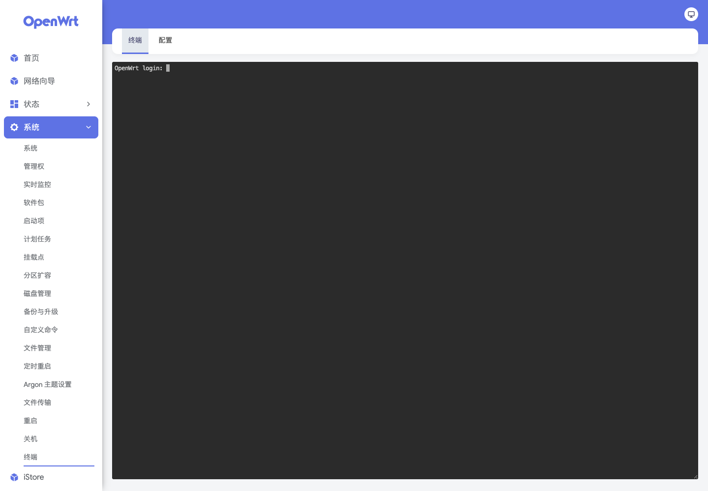
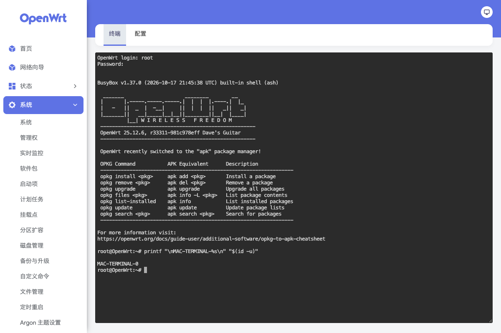
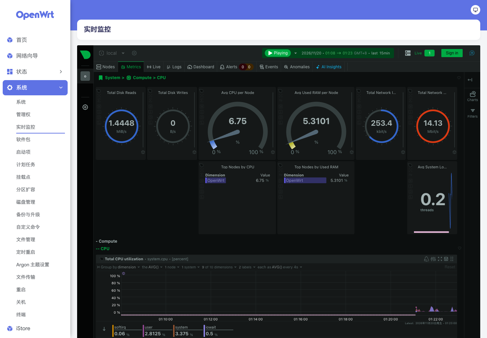

# 2026-11-20 最终镜像验收

本记录对应 v25.12.6-20261120 的同一份完整 EFI 镜像。镜像由 189 Linux 构建，固件输入提交 c90b0cc20867096a6432462719700c9fd6acbf3e，压缩文件 SHA256：

```text
842079ee87cd5ad0dbdff84d1edf22c09715441adf2177f31ad17fa301520023
```

## 全新安装与静态核对

PVE 的 9000 使用新导入的磁盘完成 EFI 安装启动，没有复用旧 overlay。原有系统盘保留作为回滚点。直接检查 squashfs 的目录权限、469 个包的版本和所有内核模块 ABI，实际安装包确认 ttyd 1.7.7-r6、官方 luci-app-ttyd 和 kmod-bonding。Netdata、ttyd、Technitium 默认启用；AdGuard Home 停用，Docker 不在镜像内。

固件默认 LAN 为 192.168.1.1/24。仅验收虚拟机改为隔离实验网 192.168.77.1/24；改址时等待接口生效后重新加载 dnsmasq，确认 DHCP 地址池也切换到新网段。系统密码只写入验收虚拟磁盘，不写入发布镜像；全新镜像的 root 密码为空，先在 LuCI 设置密码才能使用网页终端。Technitium 初始密码在每台设备首启时独立生成。

## Mac 浏览器

使用 Mac 实际 Google Chrome，通过仅监听 Mac 回环地址的受限入口访问 9000，使用全新浏览器上下文。HTTPS 使用实验自签名证书，因此自动验收上下文接受该证书；未关闭浏览器 HTTP/2。

| 项目 | 结果 |
| --- | --- |
| 登录页 | 中文登录按钮、版本页脚、布局正常；Argon 3.1.4 |
| 空密码终端 | 明确提示先设置系统密码，不能进入 shell |
| HTTP 与 HTTPS 终端 | 先有 LuCI 会话，终端再要求系统用户名和密码；认证后实际执行 id -u，结果为 0 |
| 重连与注销 | 刷新后再次要求登录；注销 LuCI 后，既有终端连接被撤销，旧会话不能重新建立连接 |
| 权限拒绝 | 未登录、伪造 LuCI 会话、错误 Origin 均无法升级 WebSocket |
| TLS 协商 | 同时提供 h2 与 http/1.1 时，ttyd 选择 http/1.1；修复 Chrome HTTPS 的 Origin 误拒绝 |
| 终端高度 | 1440×1000 与 1200×800 两种视口均使用剩余高度，底部间距 24px；保留手动垂直拖动 |
| 实时监控 | 标题与菜单均为“实时监控”；本地 v3 图表实际渲染，API 返回 168 项，包括 system.cpu |
| Technitium | LuCI 显示运行中、开机启动和 53 端口；Console 1.4.2 实际登录成功 |

Netdata 本次使用 HTTP LuCI 入口与本地 HTTP 19999 仪表盘验收。终端分别通过 HTTP 和 HTTPS 验收；本记录不将两者混为整个界面的 HTTPS 覆盖。








## 隔离客户端 9001

9001 通过 DHCP 获得 192.168.77.123/24、网关及 DNS 192.168.77.1。核对内核参数 ipv6.disable=1、无 IPv6 地址。以下检查均通过：

- UDP/TCP 查询 openwrt.lan 返回路由器地址；客户端设备名 A 记录和客户端地址 PTR 相互对应。
- example.com 返回公网 A 记录，验证默认加密上游可用。
- 指定不可达的 TEST-NET DNS 203.0.113.53 查询，UDP/TCP 均被本机 53 规则接管，nft 对应计数增加。
- Technitium Top Clients 保留客户端原地址 192.168.77.123。
- 关闭规则后，指定上述外部 DNS 的查询失败，直接查询本机仍成功；重新运行首启配置不覆盖关闭状态，恢复规则后接管恢复。
- 临时封锁 example.com 后得到 NXDOMAIN，删除测试封锁后恢复公网解析。
- 路由器重启后，Netdata、ttyd、Technitium 自动运行，强制 DNS 与公网解析仍通过；Mac HTTPS 终端再次通过登录和高度检查。

## 结束状态与范围

9000 保持新镜像运行，9001 恢复关机。实验桥无物理成员、无宿主 IP，IPv6 仍禁用；管理 namespace 无默认路由。其余 13 台虚拟机配置摘要与宿主 IPv4/IPv6 路由均与变更前一致。

本次覆盖登录页、终端、实时监控和 DNS 集成。没有在本次新镜像重新执行完整 OpenClash 代理节点分流、物理网卡 bonding 吞吐或温度/风扇硬件验收。kmod-bonding 的包和 ABI 已核对，实际网卡聚合仍由目标物理机验证。

若物理机升级后遇到问题，使用保留的旧镜像和配置备份回滚；不要覆盖旧 Release 附件。完整补丁位置见[定制补丁索引](../patches/README.md)，其中包含 ttyd r6、Netdata 标题及构建目录权限修复。
