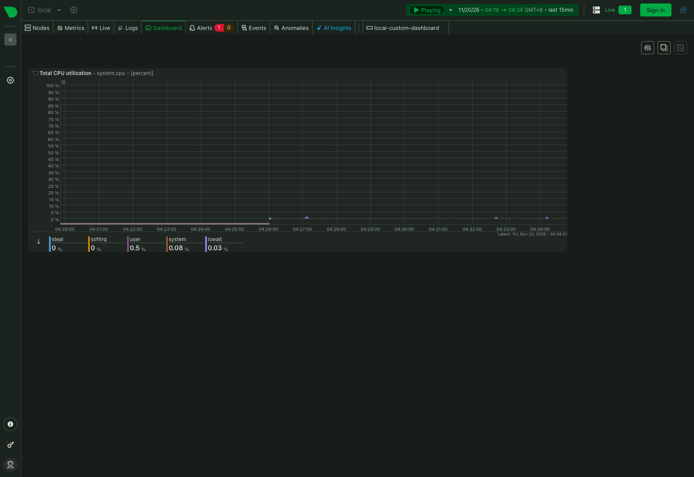
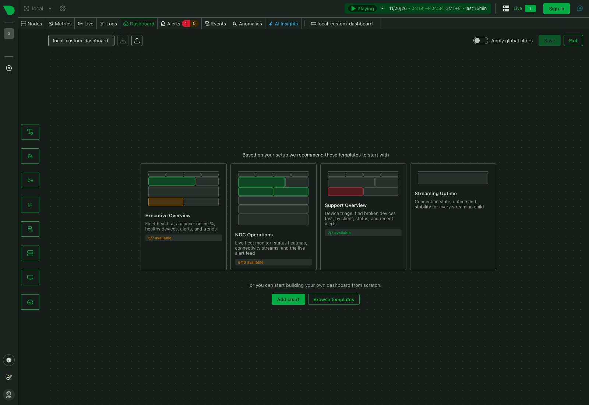

# Netdata 2.13.0 内置 Dashboard 验证

2026-11-20，验证目标是：不登录云账号、离线可用、换浏览器仍能读取统一布局，并能随固件预置为 LuCI「实时监控」默认页。

**结论：原生 Dashboard 能离线编辑、保存和显示图表，但布局保存在浏览器的 IndexedDB，不能直接当作所有客户端共享的固件默认布局。** 本轮没有修改发布固件，也没有开发独立概览页面。

## 版本与环境

- 官方最新稳定版为 [v2.13.0](https://github.com/netdata/netdata/releases/tag/v2.13.0)，发布时间为北京时间 2026-11-20 00:07。已发布固件仍固定 Netdata 2.12.3，本测试不代表固件已升级。
- 使用官方 `netdata-x86_64-v2.13.0.gz.run`，SHA256：`bb0be18228b49c9c816b87193a070ed93defdd8e366368899e39cb7d005ca6f7`。下载后校验一致，CLI 和实际运行 API 均报告 2.13.0。
- 在 189 的独立工作目录，以普通用户运行，仅监听 IPv4 回环 `127.0.0.1:29999`；Mac 入口也仅监听回环地址。没有运行上游安装脚本，没有安装为系统服务。
- Mac 实际 Google Chrome 使用两个互不共享存储的配置目录；另用实际 Safari 访问相同 Dashboard 地址。没有操作 9000、9001、实验桥、防火墙或 IPv6 配置。本轮是原生 Dashboard 能力验证，不是新 OpenWrt 镜像启动验收。

## 判定

| 要求 | 结果 | 证据与边界 |
| --- | --- | --- |
| 不登录云账号 | 通过 | `/api/v3/me` 返回 `auth: none`、`cloud_account_id: null`；页面显示 Sign in，未登录或注册账号 |
| 离线访问和绘图 | 通过浏览器侧隔离验证 | Chrome 禁用 Service Worker，并拒绝所有非本地 HTTP 请求；本地随包资源、实时 CPU 图表和原生 Dashboard 编辑器正常。没有断开 189 的管理网络，不能将此描述为整个宿主机物理断网实验 |
| 保存并在原浏览器重开 | 通过 | 使用原生界面添加 CPU 图表并 Save；关闭 Chrome 后，用原配置目录重开仍显示图表 |
| 新浏览器自动读取同一布局 | 未通过 | Chrome 第二个全新配置目录没有已保存图表；独立 Safari 访问相同地址也显示空白编辑器和推荐模板 |
| 随固件统一预置 | 原生默认行为不满足 | 布局没有随 Save 写到 Agent 的 settings 对象；仅在一个浏览器里配置，不会生成其他浏览器能自动读取的服务端 Dashboard |
| 设为实时监控默认页 | 路由可直达，统一内容未通过 | Dashboard 地址可以直接打开，但新浏览器仍是空白。仅修改 LuCI iframe URL 不能满足“首次打开就有统一概览”；本轮没有修改实际 LuCI 入口 |

Chrome 阻断的外部来源包括 Netdata Cloud、registry 和外部资源站点，本地图表仍实际渲染。Safari 用于独立浏览器保存行为对比，没有把 Safari 本次访问计为外网阻断测试。

## 保存位置

原浏览器的存储状态中可见：

```text
IndexedDB database: netdata
Object store: netdata-cache
Record key: local-custom-dashboard
Dashboard name: System Overview
Dashboard version: 1
```

同一配置目录重开后 CPU 图表仍在；第二个 Chrome 配置目录不包含该记录，显示空白 Dashboard。当前浏览器保存的标签页信息位于 localStorage，但图表布局主体在 IndexedDB，不能把二者混淆。

保存期间没有观察到向 `/api/v3/settings` 写布局的请求。保存后，Agent 的 `GET /api/v3/settings?file=default` 仍为：

```json
{"version": 1}
```

2.13.0 的 [settings API 源码](https://github.com/netdata/netdata/blob/v2.13.0/src/web/api/v3/api_v3_settings.c)确实支持 Agent 共享设置，但不能据此认定前端的 Dashboard 已使用这个接口保存；本次实际行为是浏览器本地保存。

原生界面存在 JSON 导入、导出和模板入口；本轮检查到导入流程需要选择文件。没有验证到可直接随固件下发、供全新浏览器自动使用的服务端 Dashboard 预置机制，不能将手工导入或复制浏览器配置计为固件自动预置通过。

## 截图

同一 Chrome 配置目录重开后，CPU 图表仍在：



全新 Chrome 配置目录打开相同 Dashboard 地址，仍是空白布局：



## 后续方案与结束状态

继续复用新版内置图表的方向仍成立，但还需要设计并验证“本地模板初始化”：模板随固件提供，首次访问时为当前浏览器载入，随后进入原生 Dashboard，并保留用户自行修改的布局。这属于后续定制，不是本次已通过的原生功能，也没有在本轮实现。

真正升级核心时还须修正打包脚本：2.13.0 官方 makeself 资产头为 838 行，现有提取脚本固定 830 行；不能只改版本号就构建。测试使用解析资产声明的方式提取，没有修改当前发布配方。

临时 Netdata 已正常停止，回读确认测试监听端口消失；Mac 专用 SSH 转发入口随后关闭。官方资产、独立测试状态和受控证据留在工作目录供复核。发布镜像及现有实验路由器未改动。
