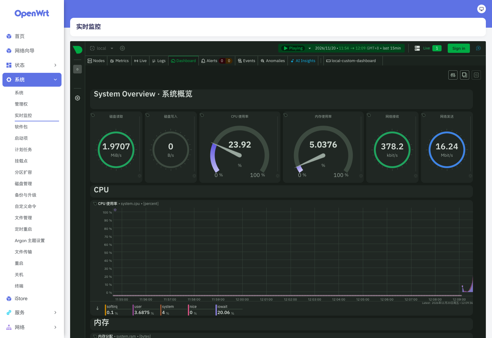
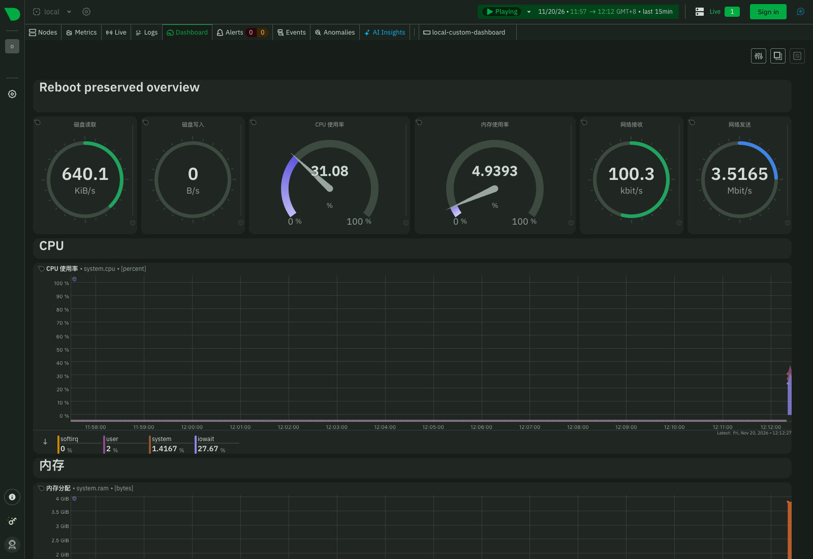

# Netdata 预置概览：实现与最终镜像验收

本轮完成了 Netdata 的本地模板初始化，保留 **2.13.0 原生 Dashboard 和原生图表渲染器**。LuCI「系统 → 实时监控」默认打开六仪表、CPU、内存、磁盘、网络和传感器分组的 System Overview。

此前[原生能力验证](netdata-native-dashboard-validation-20261120.md)中“换浏览器自动读取布局”未通过；本轮新增初始化适配后通过。不是把此前失败改写为成功，也没有恢复已归档的旧版前端。

## 实现与升级维护

- [preset.json](../packages/netdata/files/overview/preset.json) 随固件提供默认布局；[bootstrap.js](../packages/netdata/files/overview/bootstrap.js) 在原生应用启动前初始化当前浏览器的 IndexedDB，然后进入原生 Dashboard。
- 两个全新浏览器分别自动获得相同预置布局。**个人修改仍在各自浏览器保存，不跨浏览器同步**；重新进入入口或重启路由器不会覆盖已保存布局，包括主动清空的布局。
- 只初始化原生未保存的空白记录。遇到未知存储格式或存储被禁用时显示重试和完整指标页入口，不静默覆盖数据。
- 适配固定于 Netdata 2.13.0 的原生缓存结构和路由规则。默认主机名 OpenWrt 对应原生 slug `openwrt`，不能直接把显示名称拼入路由。
- [资源准备脚本](../packages/netdata/prepare-overview.py) 将页面资源限制为本地来源，并补齐原生字体的根路径；不修改原生 JS 渲染代码。浏览器对云、registry 等外部资源的尝试由 CSP 阻断，不影响本地图表。
- [提取脚本](../packages/netdata/extract-asset.sh) 解析 makeself 资产声明的边界，不执行上游安装器；2.13.0 的头部为 838 行。
- [概览打包补丁](../patches/custom-ipv4/netdata-overview.patch) 将初始化文件打进 Netdata 2.13.0-r4；[LuCI 补丁](../patches/custom-ipv4/netdata-luci-bundled-dashboard.patch) 升为 0.1-r2，标题为“实时监控”，默认入口包含资源版本标识。

后续升级核心时必须重新验证原生缓存结构、空间 slug 和图表参数；仅修改版本号不足以确认兼容。[浏览器验收脚本](../scripts/check-netdata-overview.cjs)和 [CI 工作流](../.github/workflows/check-netdata.yml)会运行真实原生页面，检查新浏览器初始化、实时 API 数值、原生编辑保存和存储失败回退。

## 最终制品

[v25.12.6-20261120.1](https://github.com/jearton/openwrt-pro/releases/tag/v25.12.6-20261120.1) 基于既有 OpenWrt 25.12.6 x86/64 方案，含 469 个包。除 Netdata 2.13.0-r4、LuCI 0.1-r2 及随包界面资源，本轮没有改变既有网络功能、DNS 策略或终端认证方案。内核模块与打包内核 ABI 逐项匹配；`kmod-bonding` 保留。

| 制品 | SHA256 |
| --- | --- |
| EFI gzip 镜像，173922242 字节 | `76f0261dc95be111813fe4e98a79b2cea81c39e718067b4f0163a90bdaa9503b` |
| 原始镜像，2164555264 字节 | `0d9d0ad3d46da0b3f8d6c4b770c7591351f0d29d2d946d3e74cec6250b7cfac0` |
| APK 清单 | `09cffda42952a347833b96df0f22e12fc18bcf64aa214bbcde7b6a0a5b3f4248` |

同一镜像经过 189、PVE、Mac 校验。PVE 导入后的全新磁盘在首次启动前也与原始镜像 SHA256 一致。先前测试盘没有作为最终产物发布。

## 验收结果

在 9000 导入上述最终镜像到新磁盘首次启动，只设置实验 LAN 和实验登录凭证。验收时虚拟 WAN 网卡断开，路由器仅有实验 LAN 路由，**没有默认路由**；Mac Chrome 同时阻断所有非本地页面请求。

| 项目 | 结果 | 证据 |
| --- | --- | --- |
| 最终镜像全新安装与默认自启 | 通过 | 实际运行 Netdata 2.13.0-r4、LuCI 0.1-r2；Netdata、ttyd 为 running |
| 离线，无云账号 | 通过 | WAN 断开；全新 Chrome 加载随包资源，六个原生仪表与曲线显示；`/api/v3/me` 为 `auth:none`、云账号为 null |
| 换浏览器自动加载预置布局 | 通过 | 两份相互独立的 Chrome 存储获得相同布局；实际 Safari 在新的来源首次访问也自动显示预置概览，没有手工导入 |
| LuCI 默认页面与中文标题 | 通过 | 从实际“系统 → 实时监控”页面进入，标题为实时监控，iframe 自动进入原生 Dashboard |
| 实时数据 | 通过 | CPU、RAM、系统磁盘 I/O、网络 API 返回有限数值并绘图，不仅检查 HTTP 200 |
| 原生编辑和个人布局保留 | 通过 | 使用原生编辑器修改、Save 后重新进入默认入口，记录不被重置 |
| 路由器离线重启 | 通过 | Netdata、ttyd 自动启动；旧浏览器保留修改且恢复实时 CPU 数值，全新浏览器自动初始化 |
| 存储异常恢复 | 通过 | 禁止 IndexedDB 时出现恢复入口；未知记录保留，不覆盖 |
| IPv6 和实验 LAN | 通过 | 内核 `ipv6.disable=1`，无 IPv6 地址文件；实验桥保持无物理上联，9001 保持关闭 |

[自动化浏览器结果](evidence/netdata-overview-20261120/browser.json)、[重启服务结果](evidence/netdata-overview-20261120/reboot.json)、[重启后原浏览器结果](evidence/netdata-overview-20261120/reboot-browser.json)。CI 的[仓库检查](https://github.com/jearton/openwrt-pro/actions/runs/44672136940)和[原生浏览器检查](https://github.com/jearton/openwrt-pro/actions/runs/44672137181)均通过。该浏览器 CI 使用独立 Linux Agent；PVE 的全新镜像验收是另外执行的，二者没有混称。

## 截图

最终镜像的 LuCI 默认入口，尚未修改浏览器布局：

使用原生编辑器修改后，路由器离线重启，原浏览器保留布局和实时图表：

## 边界与回滚

本轮“通过”针对上述 Netdata 要求。实际物理温度、RPM、传感器驱动和吞吐性能未在 VM 中验收；没有指标时显示“未检测到指标”，不伪造零值。本轮 LuCI 嵌入验收使用 HTTP，未新增 HTTPS 监控嵌入适配。

固件原有的 **Technitium DNSSEC 与默认 AliDNS DoH 对部分域名产生 SERVFAIL** 的问题仍未修复，见[既有扩展验收](vm-extended-validation-20261120.md)。不能据此报告固件所有功能全部通过。

升级前保留旧系统盘和配置。PVE 原 disk-16 保留，新镜像使用 disk-19；异常可在 9000 关机后切回原盘。物理机回滚优先使用保留的旧启动盘。当前浏览器个人布局可用原生编辑器导出；切换 Agent 版本前也应备份，不手工删除来源不明的浏览器记录。

结束状态：9000 保留最终镜像 disk-19 运行，原 disk-16 作为回滚盘保留；验收用 WAN 断链已恢复，9001 仍关闭。13 台非目标 VM 配置和宿主路由逐项核对未变。[隔离回读](evidence/netdata-overview-20261120/isolation.json)。临时普通用户 Agent、浏览器代理和本次管理密钥在验收后关闭或撤销。
